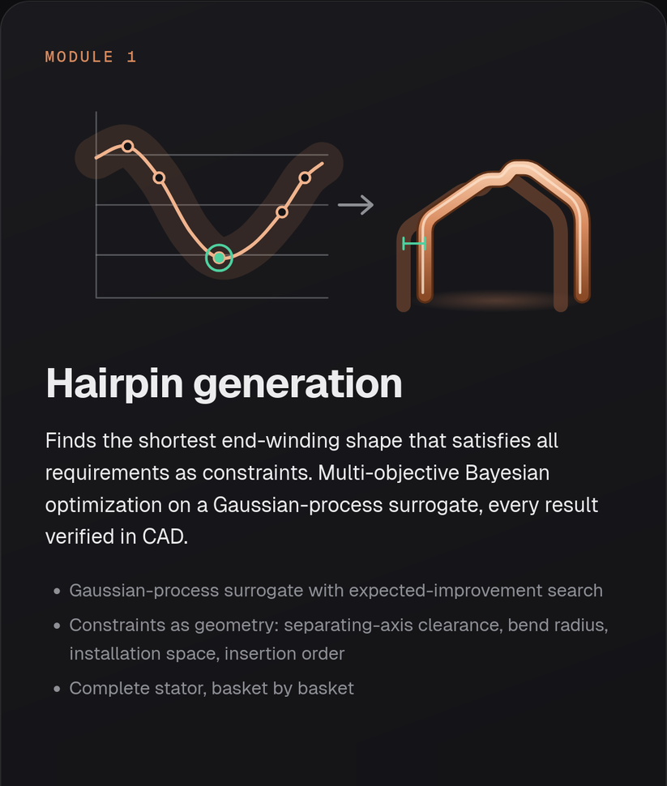
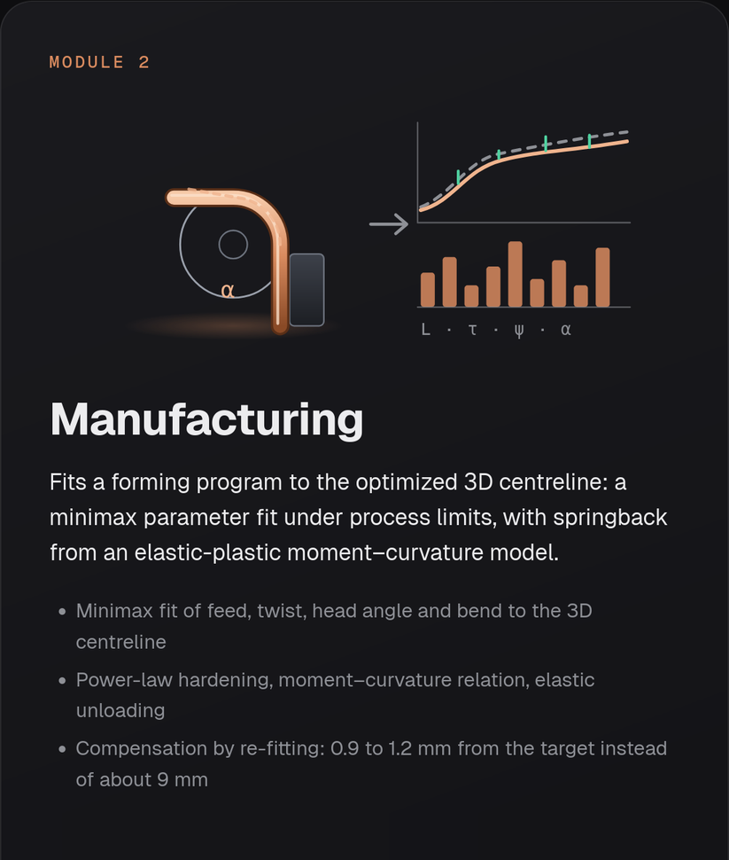

# Fronteer Hairpin – showcase

Fronteer Hairpin is a software suite for hairpin stators: winding scheme, end-winding optimization of the forming side, twist side with special legs, busbar and manufacturing up to the finished stator. Its status is a feasibility study. The chain is consistent in computation, but tooling, cooling and housing assumptions are unconfirmed and nothing has been tested experimentally. This repository is a showcase. It contains the technical report, the content of the project website and a static preview of the suite. **It contains no source code of the applications.**

Website: https://fronteerlab.com · Contact: contact@fronteerlab.com

Technical report: https://doi.org/10.5281/zenodo.23965250 (Zenodo, DOI 10.5281/zenodo.23965250 always resolves to the latest version)

  
  

## Contents

| Folder | Content |
|---|---|
| `report/` | Technical report (PDF, 4 pages, not peer reviewed; also published at Zenodo, DOI 10.5281/zenodo.23965250): constraint-driven generation and forming-program derivation for hairpin end windings. |
| `site/` | The project website, with one tab per module and the suite first (screenshots in `site/img/`): static HTML, CSS and presentation scripts (story animations, language switch), result data shown on the site, and pre-rendered videos of the hero pin and of the manufacturing animation. |
| `site/suite/` | Suite preview: a read-only build of the real interface (minified, without source maps) running on recorded results of the reference project. No server, no optimizer, no CAD, no computation kernel; shape parameters are anonymized and the bend-rule factor is removed. The bending program is shown as recorded states. `site/demo/` and `site/fertigung/` only redirect there. |
| `media/` | The two module images shown above. |

## About the app previews

The suite preview is the **real interface without a backend**: every view shows saved results, nothing is computed or saved. This protects the content of the applications. Private access to the suite is available on request: contact@fronteerlab.com.

## What this repository does not contain

- no source code of the suite or of any module and no computation: no winding, twist, busbar or manufacturing model, no optimizer, no forming or springback model, no CAD scripts (the suite preview contains only the minified interface),
- no raw results, models or CAD files; the result data on the website are normalized and anonymized,
- no build tools, scripts or configuration of the applications.

## Notes

- Results in the manufacturing module are model results for assumed material, tool and cycle-time data. No experimental validation has been carried out.
- Open `site/index.html` in a browser or serve the folder with any static web server, for example `cd site && python3 -m http.server`.

© Fronteer Lab. All rights reserved. See `LICENSE`.
